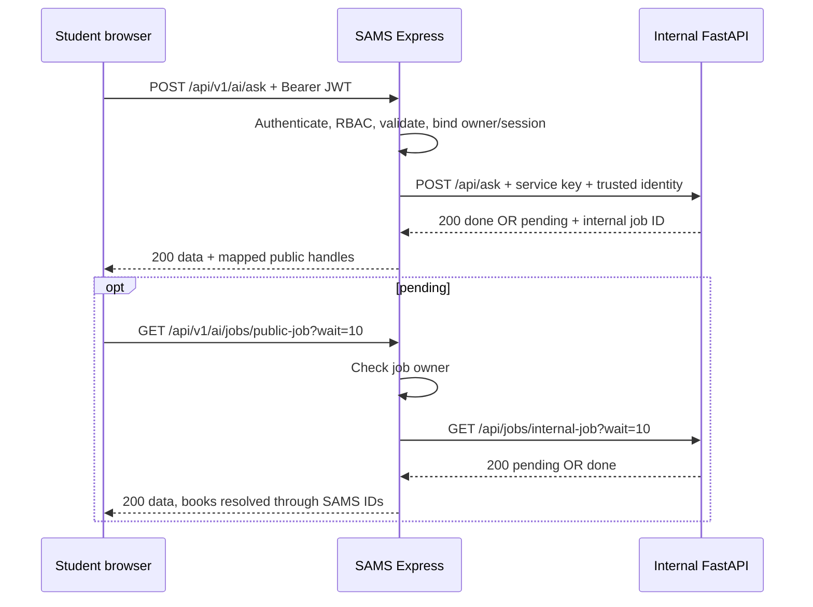

# SAMS AI Integration Contract v1

Date: 2026-10-31 (Africa/Cairo). Sprint: **10C.2, documentation only**.
SAMS baseline: branch `dev`, HEAD `017f2f7` (preceded by `0706381`, `184f675`, `70a13e4`).

**Observed** means statically verified in the supplied source/tests, not executed successfully here.
**Proposed 10D** means a normative implementation target for Express/Student clients; it does not exist yet.
No proxy, UI, database, migration, RAG, Excel, dependency, model or evaluation change is delivered by this contract.
See the [10D plan](../planning/SPRINT_10D_AI_INTEGRATION_PLAN.md) and [decision register](SAMS_AI_INTEGRATION_DECISION_REGISTER.md).

## 1. Current-state inventory and authority

The authoritative service is `RAG/sams-library-search`, **FastAPI application version 1.1.0**, a Python port of the v12 notebook. These are different version identifiers. Code wins over README, messages and PDF examples.

Read-only discovery covered this repository, `D:/Digi` and `C:/Users/Youse/Downloads`, pruning dependency/build/model directories. No `AGENTS.md` was found in the repository or its ancestor directories. This is a bounded local search, not a claim about all disks.

| Local candidate | Comparison and authority |
| --- | --- |
| `RAG/sams-library-search` | Selected; 34 files including Excel. Current `app/main.py:238` declares 1.1.0; 19 API test functions include service-key and per-user/role tests. |
| `C:/Users/Youse/Downloads/zahra/sams_rag_project.zip` | Latest observed delivered API revision. All 33 packaged regular files match local bytes; local package adds the workbook. Core ZIP timestamps are 2026-10-26; local extraction timestamps are 2026-10-28 and are not independent release evidence. |
| `C:/Users/Youse/Downloads/zahra/sams-library-searchv1.zip` | Older 1.0.0; core ZIP timestamps 2026-10-24. No service-key dependency, no per-user/role quota, unconditional CORS setup; 12 API tests. Superseded. |
| `C:/Users/Youse/Downloads/sadat library rag -20261021T100041Z-1-001/sadat library rag/SAMS_STREAMLIT_GITHUB/sams-library-search` | The five API/README/settings/test/env files have the same hashes as the older ZIP, not the chosen service. Outer dated filename alone is not a version. |
| `RAG/Hybrid_RAG_v12(run).ipynb` | Algorithm/history reference, not the HTTP contract. Local timestamp 2026-10-24; do not execute. |
| `C:/Users/Youse/Downloads/zahra/msg.txt` and the 13-page PDF `مواصفات موقع البحث الذكي في فهرس مكتبة SAMS — للمبرمج (1).pdf` in that directory | Read locally. Message identifies `sams_rag_project.zip`, server-to-server headers and Excel-first integration. PDF pp.4–10 describes the API; pp.6–7 contains a simplified Express example; p.13 defers PostgreSQL pending Subjects/other fields. Source corrections are listed below. Neither attachment is uploaded/copied into the repository. |

### Fingerprints (SHA-256, raw bytes)

Paths below the selected package are relative to `RAG/sams-library-search/`.

| Artifact | SHA-256 |
| --- | --- |
| `app/main.py` | `4e9c6a38cf7b3a51b99b2c07763b886ef7de6fdb6d2579ae78c4e6ae297b38d3` |
| `app/settings.py` | `f8c9956da1c7e1692a7c014522e0ead456ab39fd636ea61cc2781ca50751f24d` |
| `README.md` | `11d509b768aeedf57a970930330d31f9fc2fe17ded9c4cb41b9f7fb751bb4e8c` |
| `.env.example` | `092e23591e545419add136e3ab7bb7d69d05d35828a55b0b6afec1370041d497` |
| `requirements.txt` | `8d9e79e2eeed774ac0cef35990a4308e544af6690ebcf23fd458785d67e24b0c` |
| `tests/test_api.py` | `54c2a69bc6919f2e8b3e7c2ad178441ec47f6ba285c5dd70db7716ff1fdc2bc1` |
| `tests/conftest.py` | `548a8514f27a4e76ba8da8b434e1ec2c3700d74c125f1759bb3ff7306c30576e` |
| `sams_rag/engine.py` | `c18eddddc481421f377cb3e637e787fd9ba6365b40588a60745bd4297f1bdd4b` |
| `sams_rag/catalog.py` | `64961892715caca84aadb9a6e432dc032ae1217d8fb0acf3a4b0fb2f0c37806e` |
| `sams_rag/answer.py` | `9f92a2b3ee8fa5651a6d66819ffa6630441e13cced0a7f5a2a3df8ae25a9cb98` |
| `sams_rag/chat.py` | `ded30928849713eb8da0d5ef934de6112b38c3fdd4b02a3a2913f0cd98344545` |
| `sams_rag/generation.py` | `89d55cec17668bc06714e83a9d3c8a5fd807eba7c71e2d8b80a1891747ad47a0` |
| `sams_rag/config.py` | `6518b85f140bdd11be220fb7da3cab5af67ed0bac88a2fac6c78c4d659596bda` |
| Selected package manifest (34 files) | `2a7ca851b40794c42bfab7f2bf9ff9a188bc878e65af719ec7e27fc3daec9113` |
| Delivered `sams_rag_project.zip` | `7da6a84fc867ef2b41dcc70c62a9c5788c6d2980e748f7b7f4380ededb6ae122` |
| Older `sams-library-searchv1.zip` | `410bb26d9c7006528a3ffeb93b973c00711e4ed7c93694bf38a96df20ec29895` |
| Older `app/main.py` (ZIP and extracted copy) | `7982ff0a0c758439267e1a8267c71899f0913742dfbadcd711168b3478db7dbc` |
| Notebook `RAG/Hybrid_RAG_v12(run).ipynb` | `57885963f1a6e0aefe1c374ee5fb2a5a33ec541909d23aa449e057b7f901b530` |
| Zahraa PDF | `ecd76fbe9467ff1615b84a7539bf1c9a955dd52811fa1c883f4b4bcde7ed478d` |
| `data/demo/legacy-book-code-map.json` | `e8f24c22d08d0f1f2d0bd74bdc694099f17d43b23a6b9ffdddc772817d30fd6d` |
| `data/demo/books-import-payload.json` | `0367a49e6671dc96a26412e48ce61b4c42e17bd1bdcf8e77132e4c54c8fecece` |
| RAG workbook and `data/demo/SAMS_Books_Merged_Book_Names_Corrected.xlsx` (identical bytes) | `399618e7cafe2af0ae8bd3a5ca2adbde9d0a085158cc328807bc421c1e6e44e8` |

Manifest recipe: enumerate all regular files recursively in the selected package; sort relative forward-slash paths by ordinal string order; concatenate UTF-8 records `relative_path + TAB + lowercase_sha256 + LF`; SHA-256 that byte sequence. No mtimes, absolute paths or contents enter the manifest. No credentials or service-key value are recorded.

### Evidence index

Line ranges below refer to the fingerprinted local files. Links resolve from this document; the line ranges are explicit so readers need not rely on Markdown renderer support for source-line anchors.

| Ref | Source/test and exact relevant lines |
| --- | --- |
| F1 | [FastAPI main](../../RAG/sams-library-search/app/main.py): 40–58 models; 61–68 messages; 78–146 stores/limiter; 149–216 logging/worker/envelopes; 222–331 startup/auth/endpoints. |
| F2 | [API settings](../../RAG/sams-library-search/app/settings.py): 10–39 parsing and runtime defaults. [Env template](../../RAG/sams-library-search/.env.example): 1–20. |
| F3 | [API tests](../../RAG/sams-library-search/tests/test_api.py): 18–44 engine fixture; 51–62 health/done; 65–115 cache, pending, fallback, refusal, help, filters, books; 118–136 validation/rate/reset/log; 145–196 service key, user/role limits, CORS. |
| F4 | [Engine serialization](../../RAG/sams-library-search/sams_rag/engine.py): 26–31 card parsing; 35–71 result; 74–88 preview; 91–96 health. |
| F5 | [Catalog](../../RAG/sams-library-search/sams_rag/catalog.py): 18–20 Excel; 50–80 fields/merge key; 102–121 merged codes; 137 internal IDs; 150–218 card labels/building. |
| F6 | [Answer](../../RAG/sams-library-search/sams_rag/answer.py): 129–132 refusal hints; 160–201 full-list rules; 204–219 code lookup/near-duplicate cards; 246–254 help output; 291–330 staged answer/refusal. [Context](../../RAG/sams-library-search/sams_rag/context.py): 31–42 near-duplicates; 62–64 import writes CSV; 67–102 context grouping. |
| F7 | [Chat](../../RAG/sams-library-search/sams_rag/chat.py): 19–39 rewrite; 45–47 four-turn default; 65–86 begin/end/history/reset. [Generation](../../RAG/sams-library-search/sams_rag/generation.py): 66–125 each-call deadline/retries; 139–153 extractive fallback. |
| F8 | [Engine config](../../RAG/sams-library-search/sams_rag/config.py): 9–12 dotenv; 15–69 paths and evaluated settings. [Semantic](../../RAG/sams-library-search/sams_rag/semantic.py): 33–83 load/download/save; 118–136 import model/index writes. [Search](../../RAG/sams-library-search/sams_rag/search.py): 19–60 reranker import. |
| S1 | [Express mounts/parser](../../apps/api/src/app.js): 33–65 context/parser; 82–150 existing mounts, **no AI mount**. [Config](../../apps/api/src/config/env.js): 14–81 existing variables, no RAG variables. |
| S2 | [Authenticate](../../apps/api/src/middleware/authenticate.js): 8–30; [token](../../apps/api/src/modules/auth/token.service.js): 4–29; [auth service](../../apps/api/src/modules/auth/auth.service.js): 20–44, 69–79; [authorize](../../apps/api/src/middleware/authorize.js): 3–16. |
| S3 | [Errors](../../apps/api/src/middleware/error-handler.js): 29–60 parser errors, 101–174 error envelope and 5xx redaction/logging; [request IDs](../../apps/api/src/middleware/request-context.js): 3–33; [request logger](../../apps/api/src/middleware/request-logger.js): 8–51; [CORS](../../apps/api/src/middleware/security.js): 4–63. |
| S4 | [Prisma](../../prisma/schema.prisma): 82–120 User/Role; 218–260 LibraryItem/BookDetails. [Seed](../../prisma/seed.js): 26 existing role names. |
| S5 | [Discovery routes](../../apps/api/src/modules/discovery/discovery.routes.js): 12–27 authentication/400 validation, 99–111 detail. [Availability route](../../apps/api/src/modules/availability/availability.routes.js): 9–39; [availability service](../../apps/api/src/modules/availability/availability.service.js): 6–122 counts; [detail service](../../apps/api/src/modules/discovery/discovery-detail.service.js): 6–105. |
| S6 | [Import script](../../scripts/migration/import-approved-books-demo.mjs): 23–57 provenance checks; 81–86 deterministic ID function; 180–191 LibraryItem/BookDetails insertion. [Existing map](../../data/demo/legacy-book-code-map.json) and [payload](../../data/demo/books-import-payload.json): JSON `sourceSha256`, `map`, `books[].itemId/sourceBookCodes`. These resources remain local/untracked, read-only. |
| P1 | [Sprint 10](../planning/SPRINT_10_REVISED.md): S10-3/S10-4; [rebaseline](../planning/SAMS_REBASELINE_2026-10-24.md): §§5–7; [design handoff](../design/handoff/sams-living-library-v2/DESIGN_HANDOFF.md): §7; [avatar plan](../design/handoff/sams-living-library-v2/AVATAR_IMPLEMENTATION_PLAN.md.md): 10C/10D and motion events. Historical proposals do not override source or this task's scope. |

## 2. Observed FastAPI contract

### Shared headers, validation and response rules

F1:238–247, 261–331; F3:145–158. Four protected endpoints call `require_service_key`. When `API_SERVICE_KEY` is nonempty, missing/wrong `X-Service-Key` gives **401** with JSON `detail` string; when empty, the endpoints are open. Health has no dependency. There is no JWT validation in Python.

`POST` bodies are JSON models. `X-User-Id` (optional string, max 128) and `X-User-Role` (optional string, max 200) are declared **only on ask**. Roles are comma-split, trimmed and uppercased; absent user ID uses client IP for quota. These headers are not session/job access controls. Other routes ignore their identity values. No correlation/request-ID handler or service-key length validator is defined.

F1 uses no response models or explicit success status overrides: normal JSON returns are **HTTP 200**, including body `status: "error"`. Handled `HTTPException` errors use `{"detail":"..."}`. Model/query/header validation uses framework **422** `detail` issue arrays; their exact `type/msg/input/ctx` details are not pinned by the unbounded requirements file and not asserted by tests. Unexpected errors outside `_job_response` can escape as framework **500**, potentially non-JSON; the adapter must handle that. No custom FastAPI body-byte/response-byte cap, general request deadline, queue bound, cancellation endpoint or `Retry-After` header exists in these files.

| Method/path (observed) | Request/limits | Responses and explicit failure codes | Timing, quota, state, logging |
| --- | --- | --- | --- |
| `POST /api/ask` | Protected; optional identity headers above. `AskRequest` below. | 200 `done` / `pending` / body `error`; cached `done` adds `cached:true`. 401 key; 409 conversation busy; 422 validation; 429 quota; possible unhandled 500. | Worker submitted then waits `API_WAIT_S` (default 10s); search/queue/rewrite can consume wait, so preview may be null. Quota applies before session lock/cache: default 20 accepted attempts per rolling 60s per user/IP; matching unlimited role bypasses; nonpositive limit disables. Completed and cache-hit questions write query JSONL; worker exceptions use exception logger. F1:261–309, 186–216; F3:56–109,118–171. |
| `GET /api/jobs/{job_id}` | Protected; path string, no app length/format constraint. Optional `wait:float`, default 10; finite numeric values clamp to 0–25s. No explicit finite-number guard. | 200 same envelope as ask, without cache-hit flag; done/error omit job ID. 401; 404 `unknown or expired job`; 422 malformed wait; possible 500. | No quota/ownership check. Repeated reads do not start another job or renew session TTL. Wait does not cancel computation. No new query JSONL per poll; worker logging remains associated with original ask. F1:207–216,312–317. |
| `GET /api/books/{book_code}` | Protected; path string, exact source-code lookup, no app length/format constraint. | 200 `{book_code,card}`; 401; 404 `book not found`; possible 500. No done/pending state. | Synchronous card from already loaded Excel catalog, may merge near-duplicates. No quota/session mutation/query JSONL. F1:320–325; F6:204–219; F3:112–115. |
| `POST /api/session/reset` | Protected; required string `session_id`, max 64; no minimum, so empty string is model-valid. | 200 `{status:"ok",session_id}` even for unknown session; 401; 422 model errors; possible 500. | Clears history only if session exists. No ownership, busy-lock check, rate limit, job deletion/cancellation, cache purge or TTL renewal. Can race a worker, which can append history after reset. No query JSONL. F1:57–58,94–97,328–331; F7:76–86; F3:130–136. |
| `GET /api/health` | No key, user or body required. | 200 `{status:"ok",engine,settings}`; possible 500 if engine status cannot be read. No pending/error state defined. | Reports loaded engine, not provider readiness/free quota or current available worker capacity. No quota/session mutation/query JSONL. Startup loads engine before normal readiness. F1:222–258; F4:91–96; F3:51–53,154. |

Access/server logging depends on the actual ASGI launcher configuration; it is not a per-endpoint query-audit guarantee. No explicit query records are written for rejected asks, reset, books, health or polling.

### Ask and filter schema (observed)

F1:40–58,265–282; F2:33; engine behavior [filters.py](../../RAG/sams-library-search/sams_rag/filters.py):19–36,49–78.

| JSON field | Actual validation/default |
| --- | --- |
| `question` | Required string; model minimum 1 character, then Python `strip()`, rejects blank and trimmed length above runtime max (default 500). No raw body cap. |
| `session_id` | Optional string or null, max 64; unknown nonempty value creates that session; omitted/null/empty causes generated UUID hex ID. |
| `filters` | Optional model or null. Fields below default null except `topics_mode`. Unknown fields are not explicitly forbidden by these BaseModels (framework default ignores them). |
| `filters.author` | String or array of strings or null; no max string/list length. Authors use OR semantics. |
| `filters.title`, `filters.publisher` | String or null; no length bounds. |
| `filters.topics` | Array of strings or null; no item/count bounds. |
| `filters.topics_mode` | String, default `any`; API has no enum validator. Engine uses ALL only for exact `all`, otherwise ANY. |
| `filters.year_from`, `filters.year_to` | Integer or null (Pydantic conversion rules apply); no year bounds or ordering check. |
| `filters.language` | String or null, regex `^(ar\|en)$` meaning only `ar` or `en`. |

An empty filter object normally dumps `topics_mode:any`, then ask removes that sole default. Other dumps can retain it, so semantically similar filter inputs are not guaranteed identical cache keys. No browser-supplied generation/provider/evaluation options exist in AskRequest.

### Response JSON schemas (observed)

F1:207–216,285–294 defines envelopes:

| State | Exact top-level fields |
| --- | --- |
| `done` | `status`, `session_id`, `result`; only a direct cache-hit ask additionally has `cached:true` (no guaranteed `cached:false`). |
| `pending` | `status`, `job_id`, `session_id`, `message`, `preview`; `preview` is null until stage exists. |
| `error` | `status`, `session_id`, `message`. No result, structured error code or job ID. |

F4:39–88 and F1:176–183 define all nested fields:

| Object | Fields and value rules |
| --- | --- |
| `result` | `answer` string; `is_refusal` bool; `hint`, `coverage_note`, `search_query` nullable strings; `filters_applied` object; `provider` (`gemini`, `extractive`, `help` from current paths); `model` nullable string; `latency_s` number; `citations`; `sources` array; `all_books` nullable object; `notice` nullable string. API removes serializer's internal `fallback_errors` and adds `notice`. No `query`, prompt, internal integer book IDs or rewrite-method field is serialized. |
| `result.citations` | Arrays `cited`, `inferred`, `invalid` of citation-tag strings. Invalid tags do not become trusted book identities. |
| `result.sources[]` | `tag` string, `book_codes` string array, `title`, `author`, `year` nullable integer, `call_number`, `card`. Text/null values originate in catalog; no API response type enforcement. |
| `result.all_books` | `complete` bool, `items` array. Each item: `n` integer, `book_codes` string array, `title`, `author`, `year` nullable integer, `call_number`, `copies` integer, `in_answer` bool. Null for help/refusal/no used books. Broad list defaults to 30; narrow filters can return all matching groups, **not a universal 30-item cap** (F6:160–201). |
| `preview` when non-null | `search_query` nullable string, `filters_applied` object, `books` array. Each book: `tag`, `book_codes`, `title`, `author`, nullable integer `year`, `call_number`. No full card/copies/final answer. Help-stage preview is `{search_query:null,filters_applied:{},books:[]}`. |
| Book endpoint | `book_code` echoes the requested code, `card` combines its record and detected near-duplicates; it can contain more codes than requested. |
| `card` (22 exact keys) | String values, including literal `NA`: `Title`, `Authors`, `Topics`, `Subject codes`, `Publishing date`, `Publisher`, `Publisher country`, `Edition`, `Edition remarks`, `ISBN`, `Book code`, `Call number`, `Section number`, `Extent`, `Dimensions`, `Number of copies`, `Number of volumes`, `Note`, `Series`, `Copy codes`, `Copy general numbers`, `Copy other numbers`. F5:150–218. |
| Health `engine` | `books`, `chunks`, `embedding_backend`, `embedding_loaded_from`, `reranker`, `reranker_loaded_from`, `near_duplicate_pairs`, `language_changes`. Counts are integers, reranker boolean, backend/load-source values come from engine state and may be null where not loaded. F4:91–96. |
| Health `settings` | `wait_s`, `gemini_budget_s`, `rate_limit_per_min`. These do not expose the key. F1:254–258. |

### Source-derived JSON examples (not captured live responses)

IDs and timing values below are illustrative. Keys, state branches, request text and fixed messages come from F1/F3/F4/F6/F7. Examples labelled **excerpt** deliberately omit other documented fields.

Request from F3:107–109 (session can be omitted on first turn):

```json
{"question":"leadership","filters":{"author":"عبد الرحمن توفيق"}}
```

Pending while queued/retrieving; the null case is permitted by F1:191,211–212 even though F3:78–86 checks a populated preview:

```json
{"status":"pending","job_id":"0123456789abcdef0123456789abcdef","session_id":"abcdef0123456789abcdef0123456789","message":"Search results -- the assistant is still writing the answer...","preview":null}
```

Done refusal example derived from F3:96–99, F6:319–328 and F7's provider path (mock answer is reduced to the fixed refusal sentence). Numeric latency/model are illustrative:

```json
{
  "status": "done",
  "session_id": "abcdef0123456789abcdef0123456789",
  "result": {
    "answer": "المصادر المتاحة لا تحتوي على معلومات كافية للإجابة عن هذا السؤال.",
    "is_refusal": true,
    "hint": "أنا متخصص في البحث في كتب هذه المكتبة. جرّب أن تسأل عن موضوع أو عنوان كتاب أو اسم مؤلف، مثل: «كتب عن إدارة المشروعات».",
    "coverage_note": null,
    "search_query": "إزاي أعمل كيكة شوكولاتة؟",
    "filters_applied": {},
    "provider": "gemini",
    "model": "gemini-3.1-flash-lite",
    "latency_s": 1.0,
    "citations": {"cited": [], "inferred": [], "invalid": []},
    "sources": [],
    "all_books": null,
    "notice": null
  }
}
```

Worker exception (F1:213–215), **HTTP 200**, unlike an HTTPException:

```json
{"status":"error","session_id":"abcdef0123456789abcdef0123456789","message":"Something went wrong. Please try again."}
```

Actual source/test-defined errors: `GET /api/jobs/abc` with valid service authentication but no job gives HTTP 404 `{"detail":"unknown or expired job"}` (F1:314–316). Blank-after-trim question gives HTTP 422 `{"detail":"empty question"}` (F1:265–267); empty string can instead fail model validation before that branch. Invalid language `fr` gives framework 422 (F3:121), not a fixed detail string.

Book **excerpt** for `GET /api/books/1687`, the exact assertions in F3:112–115:

```json
{"book_code":"1687","card":{"Book code":"1687; 1896","Number of copies":"4"}}
```

Reset request/response (F1:328–331; no done/pending):

```json
{"session_id":"abcdef0123456789abcdef0123456789"}
```

```json
{"status":"ok","session_id":"abcdef0123456789abcdef0123456789"}
```

Health **excerpt**, using the 2821 assertion in F3:51–53, not a measured running service:

```json
{"status":"ok","engine":{"books":2821},"settings":{"wait_s":10,"gemini_budget_s":90,"rate_limit_per_min":20}}
```

### Session, cache, job and timeout semantics (observed)

- Everything is process-local: SESSIONS, CACHE, LIMITER, JOBS and a thread pool (default four workers). The executor queue is not application-bounded. Restart loses state; multiple ASGI processes do not share it (F1:78–162).
- Sessions accept caller IDs and have no owner. Idle TTL defaults to two hours; cleanup happens only on another `Sessions.get()`, not a timer. Last access means ask, not poll/reset. Cleanup can remove a still-running session from the dictionary while its worker retains the object. History keeps four completed non-help turns (F1:82–97; F7:65–86).
- One ask lock per session; a busy attempt still consumes the rate-limit admission before 409. Cache hits consume admission too. The worker releases the lock in `finally`; reset never acquires it (F1:186–204,270–305).
- Cache is shared across users and sessions. Key is normalized question plus sorted-JSON filters; default TTL 24h, maximum 2000 entries with LRU eviction. Only first-turn results whose provider is Gemini are inserted; follow-ups, help and extractive fallback are not. A Gemini refusal can be cached: there is no refusal exclusion. Cache replay inserts history into the new session. No source-version/model/user namespace or reset invalidation (F1:100–128,188–201,285–294).
- Jobs are UUID hex IDs. Their one-hour retention is measured from creation; cleanup occurs only when another noncached ask creates a job. Expired jobs may remain readable until then, or be removed while running. Poll never deletes a completed job and does not refresh its age (F1:298–317).
- `API_WAIT_S` bounds `future.result()` waiting, not execution. Pending may precede retrieval, including follow-up rewrite or queue time. The poll wait is separately clamped. There is no hard whole-job deadline or worker interruption on disconnect (F1:186–216,305–317).
- `API_GEMINI_BUDGET_S` is assigned into CONFIG on startup. `call_gemini()` creates a new deadline **per invocation**; provider HTTP attempts use up to 60s each, limited by remaining budget, with retries/fallback model selection. Follow-up rewriting and answer generation call it separately. Queueing, retrieval, list generation and logging are outside that deadline. The README/PDF claim of at most 90s for one whole question is therefore stronger than the code guarantees (F1:228; F7:19–39,66–125; F6:291–329).
- Query logging writes raw question/search/filter text, provider/model/latency/refusal/cited/inferred/fallback errors and roles; session/user identifiers are truncated SHA-256 (12 hex), **hashing, not encryption or guaranteed anonymity**. Cache hits log a smaller record. No key is intentionally recorded. Log directory creation/write failure can turn an otherwise completed worker into body `error`; exception traces may contain technical/provider information. Retention/rotation/redaction are not implemented (F1:149–157,196–215,292–294).

## 3. Proposed 10D trust boundary and Express contract

Everything in §§3–7 is **proposed, not existing SAMS behavior** unless explicitly labelled observed. Fields/codes added here have no source implementation to cite yet; their upstream/existing foundation is given in the tables above and S1–S6. Do not describe these routes as shipped.



Browser calls **Express only**. FastAPI is a private configurable origin, loopback for local development, no browser CORS permission. CORS absence is not network authentication. Require nonempty server-side shared-key configuration even locally for integration; do not rely on Python's open-key mode. No client-selected upstream URL or forward-all-headers proxy.

For every outbound call Express builds a fresh header allowlist: `X-Service-Key` from server configuration, `X-User-Id` from `req.auth.id`, `X-User-Role` from sorted/deduplicated trusted `req.auth.roles` joined by comma, and `X-Request-Id` from existing validated request context. JSON POST adds `Content-Type: application/json`; request JSON is reconstructed from validated fields. Never forward browser Authorization/cookies, `X-Service-Key`, `X-User-Id`, `X-User-Role` or identity-like body fields. Python currently consumes identity only on ask and ignores request ID; do not claim end-to-end correlation in its logs.

Authentication reuses S2: verify JWT issuer/audience, take `sub`, reload active user and roles from SAMS, set `req.auth`. **Do not use JWT role claims alone or nonexistent `req.user` from the PDF snippet.** Roles are the existing `STUDENT`, `LIBRARIAN`, `MANAGEMENT` (S4), not an invented ADMIN role.

### Route/mapping table

All browser routes require Bearer auth and return JSON with `Cache-Control: no-store` and `X-Request-Id`. Success wraps upstream state in **`{data: ...}`**, consistent with existing SAMS detail/reset-style conventions; errors use S3's **`{error:{code,message,requestId}}`**. No new 202/204 state is introduced.

| Proposed Express route | Role policy | Internal call | Proposed success contract |
| --- | --- | --- | --- |
| `POST /api/v1/ai/ask` | STUDENT only; multi-role user must include STUDENT. Staff-only users get 403; no Staff AI UI. | `POST /api/ask` with internal session ID | 200 `data.status` done/pending. Preserve result/preview/message/cached when present; replace session/job IDs with owner-bound public handles; enrich book entries below. Upstream body error is mapped to an error response. |
| `GET /api/v1/ai/jobs/:jobId?wait=10` | STUDENT + owning user | `GET /api/jobs/{internalJobId}?wait=...` | 200 `data.status` pending/done; same enrichment/ID translation. Every terminal response can include the public job ID to keep client correlation, an Express addition. |
| `GET /api/v1/ai/books/:bookCode` | STUDENT | `GET /api/books/{encodedAtomicCode}` | 200 `data` with upstream `book_code`, all 22 card keys, plus identity object below, resolved from **all** codes in returned card. This is RAG metadata, not a SAMS item-detail or cover endpoint. |
| `POST /api/v1/ai/session/reset` | STUDENT + owning user | `POST /api/session/reset` for old internal ID when safe | 200 `data:{status:"ok",session_id:<newPublicHandle>}` after rotation. Reject active/uncertain session with 409; no race with a worker. Unknown/foreign public handle gives 404. Old handle retired, jobs become inaccessible through it. |
| `GET /api/v1/ai/health` | Any existing role (STUDENT, LIBRARIAN, MANAGEMENT); no new staff UI | `GET /api/health` | 200 `data:{status:"ok"}` only after valid loaded-engine response and adapter config readiness. Do not expose engine/settings/model paths. Failure is 503. It does not guarantee Gemini availability. |

Reset's new public handle is an explicit Express difference from Python's same-ID reset. No session-list, chat-history persistence, cancel, rebuild-index, arbitrary-provider or cover endpoint is proposed.

### Proposed validation and resource limits

These are **adapter policy choices**; FastAPI's weaker actual bounds remain documented in §2.

- Strict object schemas, reject unknown keys (400 `VALIDATION_ERROR`); accept optional fields absent or null as upstream does. Trim question before count; 1–500 Unicode code points, aligned with Python `len`, not JS UTF-16 units. Do not rewrite the question or change Arabic retrieval normalization.
- Public session/job handles: opaque lowercase 32-hex random strings, max 64 accepted length before exact format/ownership check; clients never choose internal IDs. Omitted/null `session_id` on ask creates a new owned conversation. Empty string is rejected externally.
- Filters allow exactly the eight fields in §2, including `topics_mode`: author string or 1–10 strings, topics 1–10 strings; each text string 1–200 code points after trim. `title` and `publisher` 1–200. `topics_mode` enum any/all; language ar/en. Years strict JSON integers 1900–2030 with from ≤ to (matches catalog year domain F5:42–45; deliberately stricter than Python HTTP validation). No client `fuzzy_threshold` or tuning fields.
- `wait` finite decimal number 0–25, default 10; reject NaN/Infinity, arrays, duplicates, unknown query parameters. Public book code: one exact nonblank token, 1–64 code points; reject slash, backslash, controls, delimiter `;` and path traversal; URL-encode once. Do not parse as integer, remove leading zeros or perform title/ISBN matching.
- JSON POST budget **8 KiB decoded body**; require JSON media type (415 `UNSUPPORTED_MEDIA_TYPE`), malformed JSON 400, excess 413. Current global Express parser defaults to 2mb (S1); 10D must enforce smaller AI budget before expensive parsing/upstream calls, including compressed input, without breaking other routes. No file uploads or arbitrary GET bodies.
- Upstream response **2 MiB decoded bytes**, enforced while streaming before unbounded buffering/JSON.parse; final serialized browser response also ≤2 MiB including enrichment. Excess rejects with 502 `AI_RESPONSE_TOO_LARGE`, never silently cuts answer/cards/list or labels a truncated list complete. Narrow-filter lists can exceed 30, so measure this budget with fixtures before rollout. Reject malformed JSON, unknown state, mismatched session ID or invalid known fields with 502 `AI_UPSTREAM_PROTOCOL_ERROR`; build output from known fields so future upstream additions do not leak.
- Local single Express process: ask 20 admissions/user/rolling 60s across all sessions, **including multi-role users**; no staff unlimited bypass at the public gateway. At most one active/uncertain ask/user, at most four globally; reject capacity with 503 `AI_CAPACITY_BUSY`, same-session busy 409, user throttle 429. This prevents relying on Python's unbounded executor queue. Poll ≤60/user/min, max one long poll/job; cards ≤60/user/min; reset ≤10/user/min; health ≤30/user/min. Throttle excess uses 429 with conservatively computed `Retry-After`; Python remains a second quota layer. In-memory admission is local-only, not a distributed guarantee.

### Proposed ownership, lifecycle and interruption policy

An in-memory Express registry (single process in first local integration) maps `(user UUID, public session handle)` to a server-minted internal session ID, service epoch, creation/last-ask time, and idle/in-flight/uncertain/retired state. A job registry maps an independently minted public handle to owner, public session, internal job ID and creation time. Store no transcript in PostgreSQL and add no schema. Track locks/admission **before** dispatch. Reject expired/foreign/unknown handles identically with 404 before contacting Python; roles never override ownership. Session idle TTL ≤2h and job readable lifetime ≤1h from original creation; no renewal by polling. Keep a separate capacity ledger for unfinished/uncertain work even after public handles expire.

Mint the internal session ID before the first upstream ask. Once a valid upstream response arrives, check its session ID, atomically register the internal job if pending, replace IDs and return. Subsequent asks reuse the owned internal session only after previous work terminates. Do not forward caller-guessed session/job IDs.

On valid done, replace preview entirely; never merge preview books into final refusal. Extractive fallback with notice is still done, not an HTTP failure. Cache replay also undergoes fresh identity resolution; no availability is cached with the answer. Retain completed poll result for the remaining job lifetime; polling does not regenerate it. Public cache flags are advisory, not correctness/availability signals.

Reset acquires the same adapter session lock used by ask. Only idle sessions can reset; rotate both public and internal IDs on success so old history can never reappear in the new conversation. Python reset of the old idle session is history cleanup, not cancellation. On cleanup timeout/failure return mapped error; do not report reset success. Unknown upstream session silently resetting is Python behavior and does not establish it ever existed.

Browser Stop/navigation aborts its fetch/poll and stops future polling; it **does not cancel the Python thread/Gemini request**. For an ask already dispatched, Express should continue its bounded internal response read despite browser disconnect to record a pending job/terminal state; do not tie that internal read blindly to browser AbortSignal. Poll GET can be aborted safely (only the wait ends). Locks/capacity are released on observed terminal work, not because a socket closed. The existing request logger only observes finish; 10D adds a sanitized disconnect event.

If ask transport fails after dispatch and no internal job ID was learned, mark session/capacity uncertain. Never replay the POST. Error response may add **top-level `session_id`** (owned public handle) alongside the normal `error` object so the client can identify that conversation; it is an Express addition. If the browser disconnected before receiving the first handle, that conversation is not recoverable by guessing. A known session can resume polling only if a public job handle was actually received; otherwise show an explicit recovery state, with no automatic new ask/reset while work is uncertain. Operator reconciliation or a coordinated FastAPI restart clears uncertain capacity; public TTL expiry alone does not prove work stopped. This conservative behavior is a local limitation to verify in 10D, not a hidden cancellation feature.

Express restart loses its registry: old handles become 404, never pass through to still-live Python jobs. A FastAPI restart/service replacement invalidates its epoch; retire all associated handles and require a fresh conversation. Coordinated local restarts are the first-release operational rule. Automatic detection of every unannounced Python restart is not provided by current health; a deployment epoch/instance ID is a later service-contract decision.

## 4. Proposed errors, timeouts, retries and request IDs

Existing 4xx/5xx JSON envelope and redaction come from S3. AI codes below are **new proposed codes**, not existing source constants. Existing auth/parser codes stay as implemented. No raw upstream exceptions, validation `input`, provider payloads or secret header values reach the browser or error messages written to general logs.

| Trigger / upstream result | Proposed browser HTTP / error.code | Recovery / retry policy |
| --- | --- | --- |
| No/invalid/inactive SAMS user | 401 existing `UNAUTHORIZED` / `INVALID_TOKEN` | Authenticate; no upstream request. |
| Existing user lacks required role | 403 existing `FORBIDDEN` | No upstream request. |
| Bad AI input / malformed JSON / body too large / media type | 400 `VALIDATION_ERROR` / 400 `INVALID_JSON` / 413 `PAYLOAD_TOO_LARGE` / 415 `UNSUPPORTED_MEDIA_TYPE` | Correct request; no upstream. First three reuse S3/S5 conventions, 415 is proposed. |
| Foreign/unknown/expired public session or job | 404 `AI_SESSION_NOT_FOUND` / `AI_JOB_NOT_FOUND` | No owner disclosure or upstream request; new conversation only when capacity safe. |
| Upstream 200 done / pending | 200 `{data:...}` | Pending uses poll GET, never resubmits ask. |
| Upstream 200 body error | 502 `AI_UPSTREAM_ERROR` | Terminal job error; friendly localized UI, no automatic ask retry. |
| Upstream 401 service-key failure | 503 `AI_SERVICE_UNAVAILABLE` | Configuration incident, not browser 401/login loop; operator resolves. |
| Upstream 409 / adapter in-flight session | 409 `AI_SESSION_BUSY` | Continue known job; do not retry POST/reset automatically. |
| Upstream 429 / local rate throttle | 429 `AI_RATE_LIMITED` | Preserve safe fixed-language message via UI, discard arbitrary detail; local computed Retry-After, conservative 60s for upstream (it supplies none). No auto ask retry. |
| Upstream 422 after gateway validation | 502 `AI_UPSTREAM_CONTRACT_MISMATCH` | Internal contract/config drift; don't relay Pydantic input values. Browser invalid input was already 400. |
| Upstream job 404 / book 404 | 404 `AI_JOB_NOT_FOUND` / `AI_BOOK_NOT_FOUND` | Retire job handle; never auto-resubmit question. Book stays an explicit missing snapshot card. |
| Connect refused / upstream 5xx | 503 `AI_SERVICE_UNAVAILABLE` | Keep Student catalog usable; ask dispatch uncertainty follows lifecycle policy. |
| Ask/poll/card upstream deadline | 504 `AI_UPSTREAM_TIMEOUT` | Does not imply job stopped; preserve known handles, GET may retry. Health deadline maps to 503. |
| Invalid JSON/state/ID/shape / response over cap | 502 `AI_UPSTREAM_PROTOCOL_ERROR` / `AI_RESPONSE_TOO_LARGE` | No unsafe partial result; no auto POST retry. |
| Global/user concurrent capacity unavailable | 503 `AI_CAPACITY_BUSY` | Wait for existing work to finish; no provider call. |
| SAMS item missing/inactive/ambiguous | 200 with identity state, not whole-answer failure | No guessed link/availability. SAMS DB outage for enrichment is 503 `AI_CATALOG_UNAVAILABLE`; fail closed. |

Proposed internal end-to-end HTTP deadlines (connect + headers + decoded-body read): ask **15s**, poll **requested wait + 5s** (maximum 30s), card/reset **5s**, health **2s**; connection phase ≤2s within each total, not an additional budget. Keep Python initial wait ≤10s for this local profile. Browser deadlines: ask 20s, poll ≤35s, card/reset 10s, health 5s. Validate configuration relationships on startup. Enrichment/serialization must fit remaining browser budget; no unlimited DB wait.

Stop automatic polling after **240s from initial dispatch** and show still-working/retry-status state, not fake done/cancelled. Manual GET resume is allowed while ownership/job lifetime holds. 240s is a client patience policy, **not** a promise that two 90s Gemini calls plus retrieval/queue finish inside it. Do not tune the engine to make a timeout assertion pass.

Only GET polling/card/health can retry automatically, at most one transport/502/503/504 retry per user operation, with 0.5–1.5s jitter, within the original total deadline and throttles. Ordinary pending starts another explicit poll (wait=10, ≥500ms gap when it returns immediately), max one outstanding/job; not a hidden retry of ask. No retry on 401/403/404/422 or rate-limit 429. Reset has no automatic replay despite Python's idempotent clear: Express rotation is not idempotent. `Idempotency-Key` in existing CORS does not implement AI idempotency; no POST dedup guarantee exists.

Request IDs reuse S3's allowed `[A-Za-z0-9._:-]` length 1–128 or a generated UUID. IDs correlate, never authorize. Each poll has a request ID; the private registry links it to the original ask request ID. Forward `X-Request-Id` internally for future compatibility, but current FastAPI neither echoes nor logs it. Express logs only safe operation/status/duration/request ID, hashed handles and upstream status/code; no body, answer, JWT, cookies, configured URL credentials or raw header dumps. Current error handler logs err.message/stack, so create sanitized AppErrors instead of embedding upstream text. The Python raw query log remains a documented local privacy limitation; no claim of transcript erasure on reset/logout.

## 5. Book identity and availability

Observed S4: LibraryItem UUID is primary identity; BookDetails has ISBN/publisher/edition, **no native legacy-code field or Subjects relation**. ISBN is indexed, not unique. Legacy codes also appear in imported `abstractDescription` text; this is not a reliable relational key. F5:137 integer `book_id` is an internal index, not a SAMS UUID. Never join by title alone, nonunique ISBN, list number `n`, citation tag or transient internal book index.

Observed S6 map: 2,842 exact source-code keys → 2,821 distinct UUIDs; every payload `sourceBookCodes` entry agrees with `map`; both workbooks and `sourceSha256` match. These are verified **local artifacts**, not proof of current DB rows. Import script guards and deterministic IDs explain their provenance; do not run the importer or derive new IDs as a substitute for an audited map.

**Proposed 10D:** load a read-only, versioned server-side crosswalk from an explicitly configured local file. Pin its SHA-256 and workbook SHA-256; check source hash and schema/content at startup. Reject duplicate JSON keys (ordinary JSON.parse silently overwrites), malformed UUIDs, malformed/empty code tokens and multiple targets for one code; do not publish/upload local Excel/map/RAG assets. This stage creates no database mapping table and does not scan descriptions for codes.

Batch-resolve all `book_codes` in preview, sources and all_books independently of titles. Treat codes as strings without numeric conversion. For the card endpoint alone, take complete code tokens from returned `card["Book code"]`, split the source's `;` delimiter and trim delimiter spacing; do not assume requested code is the only member. Resolve every token, collect distinct UUIDs, then read SAMS to verify each target is an active BOOK with BookDetails. Do not silently select the first mapped code if any are unresolved or point elsewhere.

Proposed additional **`identity`** object on every book entry and card response: exactly `{status, library_item_id}`. `status` is `mapped`, `unmapped`, `ambiguous`, or `unavailable`; `library_item_id` is a UUID only for mapped, otherwise null. No candidate UUIDs for ambiguous/unavailable results are exposed. This object is an Express addition; RAG content/22 card keys remain intact and marked in UI as snapshot metadata.

| Resolution | Proposed behavior |
| --- | --- |
| All tokens resolve to the same one active BOOK UUID with BookDetails | mapped; set library_item_id; allow SAMS detail navigation using that UUID. |
| No code, unknown code, or partial mapping | unmapped; null ID; show snapshot metadata and explicit no SAMS link; no title fallback. |
| Codes map to >1 distinct UUID, even if titles appear equal | ambiguous; null ID; show multiple-record notice, no single detail/reservation link. A later curated crosswalk may resolve it. |
| Exactly one mapped UUID but target missing/inactive/not BOOK/missing BookDetails | unavailable; null ID; no operational link. It does not mean zero stock. |
| Crosswalk provenance invalid/unreadable | Adapter not ready, 503; never continue with an empty or guessed map. |

Concrete observed ambiguity: F3:112–115 expects card `Book code: 1687; 1896`; current map sends `1687` → `4afd2005-c0c3-5889-911a-b3952b7ef670` and `1896` → `fe19858e-1ab4-5a75-abe6-d90f07a09e6e`. RAG near-duplicate grouping (F6:213–219) differs from the exact import merge; this card must be **ambiguous**, not mapped to whichever code was requested first. This does not invalidate the atomic map.

**Proposed Express response excerpt** for `GET /api/v1/ai/books/1687` (full response retains the other 20 source card keys; wrapper/identity are new gateway fields):

```json
{"data":{"book_code":"1687","card":{"Book code":"1687; 1896","Number of copies":"4"},"identity":{"status":"ambiguous","library_item_id":null}}}
```

Availability and reservation remain SAMS operations. After mapped navigation use existing authenticated `GET /api/v1/discovery/items/:id` or `GET /api/v1/catalog/items/:itemId/availability` (S1/S5), and existing reservation policy/routes. AI does not reserve anything. Do not add availability fields computed from RAG `copies`, `Number of copies`, `Copy codes`, shelf wording or answer text. These are Excel snapshot fields; even a current SAMS synthetic/demo inventory count must retain existing demo/unverified presentation. A mapped book with zero available SAMS copies is still mapped; the operational API determines stock. The AI contract carries no live availability, book-cover URL or cover-enrichment metadata.

## 6. Environment names and local startup order

Names only below: no deployment values, URLs with credentials, key values or real JWTs. Defaults/limits elsewhere describe source behavior, not a copied environment file.

| Component | Observed or proposed environment variable names |
| --- | --- |
| FastAPI observed, F2 | `API_WAIT_S`, `API_GEMINI_BUDGET_S`, `API_RATE_LIMIT_PER_MIN`, `API_UNLIMITED_ROLES`, `API_SERVICE_KEY`, `API_CACHE_TTL_S`, `API_CACHE_MAX_ITEMS`, `API_SESSION_TTL_S`, `API_MAX_QUESTION_CHARS`, `API_WORKERS`, `API_ALLOWED_ORIGINS`, `API_LOG_DIR`. `API_CACHE_MAX_ITEMS` exists in settings but is absent from .env.example. |
| RAG observed, F8/F7 | `SAMS_DATA_PATH`, `SAMS_STORE_DIR`, `SAMS_MODELS_DIR`, `LLM_PROVIDER`, `GEMINI_MODEL`, `GEMINI_API_KEY`; generation also accepts `GOOGLE_API_KEY` as a fallback alias, absent from .env.example. |
| SAMS observed, S1 | `NODE_ENV`, `API_PORT`, `WEB_ORIGIN`, `DATABASE_URL`, `AUTH_TOKEN_SECRET`, `AUTH_TOKEN_EXPIRES_IN`, `DEV_AUTH_ENABLED`, `API_JSON_LIMIT`, `REQUEST_LOGGING`, `GRACEFUL_SHUTDOWN_TIMEOUT_MS`. |
| Express proposed 10D (not in env.js today) | `AI_ENABLED`, `RAG_URL`, `RAG_SERVICE_KEY`, `AI_BOOK_CODE_MAP_PATH`, `AI_BOOK_CODE_MAP_SHA256`, `AI_SOURCE_SHA256`, `AI_SERVICE_EPOCH`, `AI_ASK_TIMEOUT_MS`, `AI_CARD_TIMEOUT_MS`, `AI_RESET_TIMEOUT_MS`, `AI_HEALTH_TIMEOUT_MS`, `AI_POLL_TIMEOUT_MARGIN_MS`, `AI_REQUEST_MAX_BYTES`, `AI_RESPONSE_MAX_BYTES`, `AI_POLL_WINDOW_MS`. Config validation must enforce the profile in §§3–4. |

`RAG_URL`/`RAG_SERVICE_KEY` follow PDF vocabulary but are new to SAMS. They are server-only and never Vite-prefixed. Disabled adapter should not block ordinary SAMS startup; enabling with missing key/map/config must fail closed for AI. Paid hosting/subscriptions/quota upgrades are excluded.

**Future local runbook; none of these services/commands was run in 10C.2:**

1. Confirm selected fingerprints, safe existing local PostgreSQL instance/schema/catalog and read-only crosswalk. Do not migrate/seed/import to make AI work; verify active target BOOK rows with a read-only check in 10D.
2. Obtain an already prepared Python environment plus authorized local offline model/cache artifacts. This checkout has no `.venv`, `models` or `rag_store`; default interpreter has none of pytest/FastAPI/httpx/pandas/sentence-transformers. Do not start engine/tests here to trigger implicit downloads/index writes. Runtime preparation is a separate prerequisite, not permission to install or download now.
3. Configure FastAPI environment in the process **before imports**, especially all API settings; restrict browser origins, require shared key, choose the authorized no-paid-service profile. `app.settings` reads os.environ before `sams_rag.config` calls load_dotenv in lifespan: a plain README `.env` copy does not ensure API settings are loaded. In a prepared environment, explicit Uvicorn `--env-file .env` (existing python-dotenv requirement) or process injection avoids that ordering issue.
4. From `RAG/sams-library-search`, future command `uvicorn app.main:app --env-file .env --host 127.0.0.1 --port 8000 --workers 1`; only after artifacts are ready. HTTP health then confirms engine loading, not model-quality equivalence or provider quota. Extractive mode provides free fallback; it does not promise Gemini-written answers. No algorithm/evaluation setting changes are authorized.
5. After implementation, configure Express with the matching server key, configurable RAG origin, pinned map/source and service epoch. Start existing `npm run dev:api` from repo root (root/package + apps/api/package scripts); check SAMS health and proposed AI health. Use one Express process and coordinated service restarts locally.
6. Start existing `npm run dev:web`, authenticate through existing SAMS flow, and exercise Student AI only against `/api/v1/ai`. Knowledge Spirit consumes these states and makes no separate FastAPI calls. Never expose the internal service in browser configuration or tunnel it publicly.

## 7. Verification, acceptance and limitations

10C.2 verification is static: source/test/schema inspection; archive byte comparisons; SHA-256 manifests; local map/payload consistency and workbook byte comparison; local PDF text extraction. No FastAPI/Express service, pytest, Gemini, build_index, evaluation, model download or database query was run. README/PDF claims of 58 passing tests and evaluation scores are **supplier history**, not a result of this audit. Existing API tests run lifespan and import the engine (F3:18–20), which can download models/write vectors/CSV (F8); mocking Gemini alone does not make them safe here.

10D is acceptable only when tests using a controlled fake upstream first demonstrate all five routes, exact envelope/state handling, all fields above, forged-header rejection, current RBAC/user checks, cross-user session/job/reset denial, same-session concurrency, quotas/capacity, invalid media/body/response/shape rejection, timeouts/disconnect/uncertain dispatch, no unsafe POST retry, coordinated restart/expiry, and every identity state including the real 1687/1896 ambiguity. Then use the authorized prepared service locally and label actual-vs-mocked evidence. Preserve refusal/fallback/help/cache semantics and catalog/circulation regression behavior. No live-provider test may incur payment.

Remaining before an actual local integration smoke: prepared offline environment/artifacts, secure matching key configuration (value not recorded here), operator-owned map/epoch files and read-only current DB mapping verification, and confirmation of free-provider availability or explicit extractive-only demo. Production hosting, distributed state, log privacy/retention and durable ownership are separate future decisions; they do not authorize source/DB changes in this sprint.
