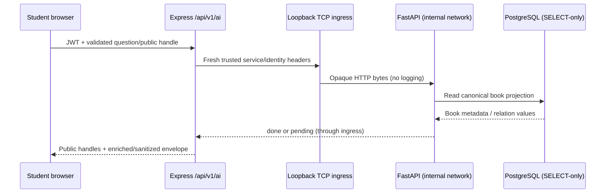

# Sprint 10D.3 — real Linux Book RAG and dynamic PostgreSQL

Verified 2026-11-05 (Africa/Cairo), `dev @ e8d80c6`. **Local functional validation passed. Production/default feature flags remain disabled.** No stage, commit, push, branch switch, schema migration or persistent main-DB write.

## Result and evidence boundary

The actual limited PostgreSQL account read **2,821 active books / 2,842 legacy-alias rows**. The complete catalog produced **2,821 books / 2,903 chunks** with the existing local E5 encoder, FAISS/BM25 and mMARCO reranker. Real Arabic/English questions, Express enrichment and the Student AI page completed against this service. These are actual local HTTP/model/DB/browser observations, not a fake upstream substituted for completion.

The original Windows pandas extension remains blocked by Smart App Control/Code Integrity. The approved Linux container replaces only the Book RAG execution environment. No policy, exception, binary replacement, security setting or bypass was attempted. Original `RAG/sams-library-search` remains byte-identical across its **34 pinned files**, including workbook and original configuration. Projects/Research/Hybrid, Staff, covers, original Excel/data/HOLD assets, Prisma/schema/migrations and Node dependencies/lockfiles are unchanged.

Current final live evidence: `live-accepted/` (23 successful scenario checks). Earlier `live-final/` contains the initial successful 21 checks; `live-verified/` records a later harness failure before the final successful rerun. Neither earlier run is substituted for the final result. All evidence is outside the repository:

`D:/Digi/SAMS_Library_System_Root/sprint10d3-linux-evidence-20261104`

Review package: `D:/Digi/SAMS_Library_System_Root/SPRINT_10D3_LINUX_REVIEW_2026-11-05.zip`.

## Runtime and trust boundary



- Express authentication, current DB-backed roles, ownership/admission, unknown/foreign-handle behavior, uncertain POST dispatch protection, limits, deadlines, GET-only retry policy and response projections are retained. The server-only identity mode adds exact native UUID codes; it does not trust browser identity headers or JWT role claims alone.
- `sams-postgres` keeps its existing Compose network, port and data volume. A second owned **internal** bridge gives it the fixed `postgres` alias. Book RAG has only this internal network. No host.docker.internal or arbitrary public/LAN DB allowlist was added. Container mode permits only the literal postgres:5432 endpoint; resolved Python socket peers are pinned to that private DB peer.
- Docker 29 did not publish an internal-only container's port: its HostConfig requested a bind but NetworkSettings had no published port, and host connections were refused. A separate stdlib TCP ingress attaches to the internal and ingress bridges and publishes **127.0.0.1:18000**. It forwards only to the fixed Book RAG container/8000 in its internal subnet. It has no model/store mounts or configured credentials, performs no HTTP parsing/logging, and bounds connections/buffers/idle time (32 / 64KiB / 30s). Opaque header bytes transit memory only. This is transport plumbing; React still calls Express only.
- Both runtime containers use UID 10001, read-only roots, dropped capabilities and no-new-privileges. Models/map are read-only mounts; the vector store is a separate named volume outside Git/image. Password/key enter PID 1 by stdin, never image/build arguments/argv/Docker Config.Env. `runtime-isolation-audit.json` inspected the actual running containers and verified these properties without emitting environment values.
- Both models use local_files_only, CPU, offline/telemetry flags and pinned MODEL_PROVENANCE.json hashes. The RAG network has no Internet egress. A separate actual two-model inference probe also ran with Docker **network=none**, returning finite (2,384) embeddings and two reranker scores, with zero denied-network attempts. No Google SDK or CUDA packages are installed in this image. No Gemini/model download occurred during runtime.
- Questions, filters, answers and internal FastAPI job/session IDs are not logged or persisted. Operational events contain fixed names and a boolean only; uvicorn access logging is off. The passage cache contains catalog vectors, not question/transcript vectors. Browser conversation behavior remains the accepted in-memory D2 implementation.

## Source and refresh decisions

[PostgresProvider](../../services/book-rag/app/data_sources.py) reads active BOOKs with BookDetails and the six permitted tables: library_items, book_details, contributors, item_contributors, categories and dewey_classifications. It projects title, authors/contributor roles, ISBN, publisher, edition, year/language/call number/abstract and actual Category/Dewey labels/codes. The real DB has no sourceBookCode or Subjects relation; BookDetails/Contributor links lack adequate updatedAt coverage. Missing bibliographic/copy fields stay unknown; no physical-copy query is made. ExcelProvider is explicit legacy-only, never an error fallback.

Canonical fingerprints include **the selected source rows and converted records**. Thus relation/details changes and role-only edits invalidate even if a flattened name stays identical. The default poll is 5s; unchanged revisions do not rebuild. A changed catalog builds an isolated module snapshot and atomically publishes it; in-flight stages retain their own snapshot. Shared local models/content-keyed vectors avoid re-embedding unchanged passages. The role-only live check confirmed a new publication with no extra encoded vectors.

The 30s stale guard timestamps the DB observation, not completion of a potentially long build. DB/refresh failure rejects health/ask/cards explicitly; no empty map, stale-success fallback or automatic Excel fallback. This is fail-closed freshness protection, **not a universal 5s/30s indexing SLA**. Cold/bulk updates can exceed the guard; capacity/SLA remains to be measured for larger workloads. The measured insert/update cases use an isolated small fixture, not a production-size write benchmark.

Persistent NPZ publication uses temporary-file plus atomic replacement; shape/type/finite validation and allow_pickle=False reject invalid stores. Restart reads PostgreSQL again, restores passage vectors and rebuilds in-memory FAISS/BM25. It does not restore an old catalog snapshot blindly. Only one process/writer may own a store. Corruption fails closed; no existing cache/index is deleted or automatically rebuilt as a false success.

## Identity and availability

The immutable imported-code crosswalk remains pinned by raw SHA-256/source provenance. Existing codes retain leading zeroes. A PostgreSQL item without a legacy alias gets `sams:<LibraryItem UUID>` as its source code, without a new DB column or manual file export. The server must explicitly select AI_BOOK_IDENTITY_MODE=postgres_uuid (legacy remains default). All targets still pass the existing batched read-only active BOOK + BookDetails validation; no title/ISBN/description matching.

The actual 1687 card returned both 1687 and 1896. Actual Express returned `{status: "ambiguous", library_item_id: null}`. Source native-code generation/search/chat was exercised by isolated insert/update; an additional constructed-code-group smoke used **real read-only Prisma**, resolving mapped/ambiguous/unavailable in one batch. That adapter smoke uses constructed inputs and is labeled separately from real FastAPI retrieval. No new UUID was inserted into sams_library.

Preview, source, all_books and card enrichment continue to resolve all returned codes. Partial/missing mappings remain unmapped; multiple UUIDs ambiguous; invalid/inactive targets unavailable. RAG copy fields never authorize availability/reservation; existing SAMS Details/Availability/Reservation routes remain authoritative. No cover fields or reservation actions were added.

## Actual measurements

| Measurement | Observed |
| --- | --- |
| Cold passage/index build | 523.099s; 2,903 vectors encoded, both local models loaded |
| Final startup using persisted vectors | 61.271s |
| Final explicit restart | 47.727s; 2,903 restored / zero re-encoded |
| Actual main provider fetch | 0.320s for 2,821 items / 2,842 aliases |
| Final Arabic retrieval | 11.236s / 4 sources |
| Final English retrieval | 7.398s / 5 sources |
| isolated insert visible to retrieval without restart | 5.121s |
| isolated title and detail update without updatedAt or restart | 5.029s |
| isolated contributor relation visible without restart | 4.983s |
| role-only change invalidates without re-embedding unchanged text | 5.515s |

The cold build was measured before the metadata-only fingerprint correction; final runs reuse the same model/content-keyed passage vectors and rebuild the complete fresh catalog index. No retrieval parameter or embedding text was changed by that correction. Measurements describe this local CPU machine and test workload, not a production latency promise.

Storage preflight recorded D free 16,999,575,552 bytes and C free 349,791,457,280 bytes; a separate earlier mount probe observed D about 13.9GB. Both exceeded 5GiB. The actual mounted store filesystem is checked before building. Docker provided 12 CPUs / 8,234,250,240 bytes RAM. No additional model/dependency preparation was required on Windows.

## Permissions and data preservation

The Linux runtime used the operator's existing sams_book_rag_ro DPAPI credential, not postgres. SELECT succeeded on exactly the six public tables. Counts: library_items 2821, book_details 2821, contributors 4059, item_contributors 4059, categories 0, dewey_classifications 9. Privileged-role/write ACL checks passed. INSERT/UPDATE/DELETE/CREATE/ALTER/DROP probes were denied with SQLSTATE 25006 in read-only transactions; DML used WHERE false and every probe rolled back. Protected users/user_roles/students/audit_logs/idempotency_records reads failed 42501. No session/token tables exist in this JWT schema; no nonexistent table is claimed as a permissions test.

Dynamic insert/update/contributor/role tests wrote only to a separate tmpfs fixture database/container with the same limited runtime role name/grants. Its synthetic setup has no published DB port, no production data or production password, and never connects as a writer to sams_library. The fixture's trust authentication is scoped to its separate internal network. Stopping that fixture DB caused actual readiness and ask 503. Corruption used only a store created by this Sprint; missing stdin credentials exited 78 before source/models. Main catalog fingerprints and all six table counts matched before/after. Main PostgreSQL was never stopped.

## Verification (live separated from deterministic)

| Command / evidence | Result |
| --- | --- |
| Test-LiveBookRag.ps1 → live-accepted/completion.json | **23 live checks passed**, real PostgreSQL/models/FastAPI/Express/Student browser; all six flag/language combinations |
| tests/offline_models.py in Docker --network none | Actual encoder + reranker inference passed; 66.218s model load / 1.510s inference; no attempted egress |
| live-native-identity.mjs . | Constructed code groups + real read-only Prisma: mapped / ambiguous / unavailable, one batch |
| Existing sprint9b-live-auth-smoke.js / sprint9c-live-discovery-smoke.js | Passed unchanged against an additional read-only Express instance; actual auth/current roles/discovery/availability/privacy |
| docker run … python -m unittest discover -s tests -v | **13/13**; unit/fake-builder policy/conversion/invalidation tests, network none; no real RAG substituted here |
| npm run test -w @sams/api -- tests/ai-gateway.test.js tests/ai-postgres-identity.test.js | **144/144**, fake upstream/mocked Prisma; 139 unchanged gateway cases + five native-identity cases |
| npm run test -w @sams/api -- tests/app.test.js tests/catalog-search.test.js tests/hardening.test.js tests/error-handler.test.js | **39/39**, existing deterministic API regressions |
| node --test apps/web/tests/ai-controller.test.mjs apps/web/tests/i18n.test.mjs | **50/50**, deterministic client/controller/i18n |
| node --test apps/web/tests/ai.browser.test.mjs | **54/54**, mocked Express scenarios, including production absent/false/on builds and 320px AR/EN geometry |
| node --test --test-concurrency=1 apps/web/tests/student-home.browser.test.mjs apps/web/tests/catalog.browser.test.mjs apps/web/tests/item-details.browser.test.mjs | **62/62**, mocked Student regressions; student-regressions.tap is included in this review package |
| Vite production builds with explicit absent / false / true definitions | All three passed; separate absent/true outputs outside repo, ordinary ignored dist for false |
| npm run build -w @sams/api; node --check (six changed/new JS/MJS); git diff --check | Passed. API is plain ESM; no API lint/type-check script exists |

Real browser absent/false AR/EN each made **zero AI requests**. Real true AR/EN displayed extractive answers/source metadata through Express only, with no unexpected origin. The 320px element captures show real answers; fixed shell/header/navigation overlays remain visible in these tall capture artifacts, including the account avatar initials. No bearer token, password or private question is shown. Deterministic browser suites additionally cover dark/light, RTL/LTR, reduced motion, keyboard/focus, errors, ownership/handle recovery, mapped-only links and unchanged Student/Staff boundaries. No full real-service accessibility/relevance/production-load audit is claimed.

The production browser modes require the corresponding build directories. The actual invocation used these non-secret environment settings before the browser command (and ran Student regressions separately):

```powershell
$env:SAMS_TEST_EVIDENCE_DIR='D:\Digi\SAMS_Library_System_Root\sprint10d3-linux-evidence-20261104\browser-fixtures-final'
$env:SAMS_AI_ABSENT_BUILD_DIR='D:\Digi\SAMS_Library_System_Root\sprint10d3-linux-evidence-20261104\build-absent'
$env:SAMS_AI_ENABLED_BUILD_DIR='D:\Digi\SAMS_Library_System_Root\sprint10d3-linux-evidence-20261104\build-true'
node --test --test-reporter=tap apps/web/tests/ai.browser.test.mjs
```

The review evidence includes build-web.mjs with the exact programmatic Vite configuration: explicit absent/false/true definitions, envFile=false, separate absent/true outputs, and the false build in ignored dist. This helper is verification evidence outside the repository, not a new application dependency.

Initial parallel browser runs had Vite EPERM/cache timing failures and one Details load timeout; unchanged suites passed when rerun separately. No old assertion was edited. A later live harness lacked the gateway's 500ms pending-poll floor and failed at a gateway HTTP assertion; the initial status was not captured. The test client now spaces GETs, retains the same job and never replays POST; final live checks passed. Gateway validation/locks were not changed. A Docker extraction snapshot error resolved on a cached retry without prune, security changes or a new dependency download; its diagnostic log is retained.

## Versions and reproducibility

Python **3.12.16**, torch **2.15.0+cpu** (CPU), sentence-transformers **6.2.0**, transformers **5.22.1**, pandas **3.1.0**, psycopg **3.3.6**, FastAPI **0.162.0**. The 68-package transitive Linux lock contains wheel hashes; CPU PyTorch is an explicit official wheel URL (209,530,490 bytes). The base is Python 3.12 slim-bookworm pinned to sha256:e697c81897302a4c4333bade000d98038fbb21eb064f8ee1fd42d02ebcd9d337. Package resolution was recorded before the build; Linux pip freeze, image/version audit and source/model manifests are in evidence. No Node install/manifest/lock change.

## Local startup and environment names

Order: Docker Desktop/Linux → existing PostgreSQL → build image → opt-in RAG → explicitly configured Express → explicitly enabled Student web. The executable end-to-end harness creates an ephemeral key, passes DB credentials on stdin, configures Express in memory and closes test containers/servers afterward:

```powershell
docker build --tag sams-book-rag:10d3 services/book-rag
& services/book-rag/Test-LiveBookRag.ps1 `
  -CredentialPath 'D:\Digi\SAMS_Library_System_Root\SAMS_Book_RAG_Runtime_10D3\credentials\book-rag-postgres.clixml' `
  -ModelsPath 'D:\Digi\SAMS_Library_System_Root\SAMS_Book_RAG_Runtime_10D3\models' `
  -EvidencePath 'D:\Digi\SAMS_Library_System_Root\sprint10d3-review-local'
```

For foreground FastAPI, supply the same server-only RAG_SERVICE_KEY securely to the RAG launcher and Express process (never print/write it), then use Start-BookRag.ps1 with CredentialPath/ModelsPath. [README](../../services/book-rag/README.md) documents mounts/ports/profile and the harness. Existing root Compose/startup remains untouched; standalone compose.yaml is opt-in and cannot receive secrets from detached up alone.

Names only: BOOK_RAG_CONTAINER, BOOK_RAG_SOURCE, BOOK_RAG_PGHOST, BOOK_RAG_PGPORT, BOOK_RAG_PGDATABASE, BOOK_RAG_PGUSER, BOOK_RAG_PGPASSWORD, BOOK_RAG_MAP_PATH, BOOK_RAG_MAP_SHA256, BOOK_RAG_SOURCE_SHA256, BOOK_RAG_REFRESH_SECONDS, BOOK_RAG_MAX_STALE_SECONDS, BOOK_RAG_MODELS_HOST_PATH, BOOK_RAG_MAP_HOST_PATH, BOOK_RAG_INTERNAL_SUBNET, BOOK_RAG_TARGET, BOOK_RAG_EVIDENCE_DIR, SAMS_MODELS_DIR, SAMS_STORE_DIR, API_SERVICE_KEY, API_ALLOWED_ORIGINS, API_UNLIMITED_ROLES, LLM_PROVIDER, HF_HUB_OFFLINE, TRANSFORMERS_OFFLINE, HF_HUB_DISABLE_TELEMETRY. Existing server names AI_ENABLED, RAG_URL, RAG_SERVICE_KEY, AI_BOOK_CODE_MAP_PATH, AI_BOOK_CODE_MAP_SHA256, AI_SOURCE_SHA256, AI_SERVICE_EPOCH, AI_BOOK_IDENTITY_MODE remain server-only. The only new-page browser switch is the existing non-secret VITE_AI_ASSISTANT_ENABLED.

## Remaining limits / production decisions

- Production hosting/TLS, secret distribution/rotation, multi-instance ownership/epoch coordination, process supervision and store backups/repair remain deferred. Restart Express with a fresh AI_SERVICE_EPOCH whenever the RAG process/key restarts; never replay uncertain ask/reset work.
- One RAG process and one writer per vector volume; 10,000 source-row / 20,000 active-vector caps. Model access is serialized with two CPU threads. Initial build takes minutes; current local AR/EN answers take seconds/tens of seconds. Larger/bulk refresh and production concurrency/SLA need capacity testing. Stale-source failure can reduce availability deliberately.
- Native source generation was tested with real isolated DB insert/update, and native resolver DB validation separately with constructed inputs. No new main-DB book or production import was created. This is intentional preservation, not a claim of a live production insertion test.
- Category is empty in current main data; Subjects/missing metadata/Projects RAG remain later work. Extractive results are not a completed relevance evaluation or generative answer quality audit. No paid provider or new UI scope.
- Windows native pandas remains blocked; no manual security change is needed for this Linux runtime. Docker must keep running, models/credential must remain available externally. No additional manual preparation blocker remains from this verification.

## Exact cumulative D3 repository scope

49 files: four tracked modifications preserved from earlier D3 preparation and 45 untracked D3 files. Other pre-existing untracked/HOLD files remain preserved. This Linux continuation edits only services/book-rag and this report; it preserves the earlier four API/config changes byte-for-byte. The source bundle excludes the pre-existing root .env.example contents; its exact new delta is in tracked.diff.

| File | Git scope |
| --- | --- |
| `.env.example` | Modified tracked file (earlier D3 preparation preserved) |
| `apps/api/src/config/ai.js` | Modified tracked file (earlier D3 preparation preserved) |
| `apps/api/src/modules/ai/ai-gateway.js` | Modified tracked file (earlier D3 preparation preserved) |
| `apps/api/src/modules/ai/ai-identity.js` | Modified tracked file (earlier D3 preparation preserved) |
| `apps/api/tests/ai-postgres-identity.test.js` | New D3 file, untracked |
| `docs/planning/SPRINT_10D3_REAL_RUNTIME.md` | New D3 file, untracked |
| `services/book-rag/.dockerignore` | New D3 file, untracked |
| `services/book-rag/.env.example` | New D3 file, untracked |
| `services/book-rag/.gitignore` | New D3 file, untracked |
| `services/book-rag/Dockerfile` | New D3 file, untracked |
| `services/book-rag/MODEL_PROVENANCE.json` | New D3 file, untracked |
| `services/book-rag/README.md` | New D3 file, untracked |
| `services/book-rag/SOURCE_PROVENANCE.json` | New D3 file, untracked |
| `services/book-rag/Start-BookRag.ps1` | New D3 file, untracked |
| `services/book-rag/Test-LiveBookRag.ps1` | New D3 file, untracked |
| `services/book-rag/app/__init__.py` | New D3 file, untracked |
| `services/book-rag/app/catalog_runtime.py` | New D3 file, untracked |
| `services/book-rag/app/container_entry.py` | New D3 file, untracked |
| `services/book-rag/app/data_sources.py` | New D3 file, untracked |
| `services/book-rag/app/local_models.py` | New D3 file, untracked |
| `services/book-rag/app/main.py` | New D3 file, untracked |
| `services/book-rag/app/operational_logging.py` | New D3 file, untracked |
| `services/book-rag/app/runtime_safety.py` | New D3 file, untracked |
| `services/book-rag/app/settings.py` | New D3 file, untracked |
| `services/book-rag/app/tcp_ingress.py` | New D3 file, untracked |
| `services/book-rag/compose.yaml` | New D3 file, untracked |
| `services/book-rag/requirements-linux.in` | New D3 file, untracked |
| `services/book-rag/requirements-linux.lock` | New D3 file, untracked |
| `services/book-rag/requirements-source.txt` | New D3 file, untracked |
| `services/book-rag/run-container.mjs` | New D3 file, untracked |
| `services/book-rag/sams_rag/__init__.py` | New D3 file, untracked |
| `services/book-rag/sams_rag/answer.py` | New D3 file, untracked |
| `services/book-rag/sams_rag/catalog.py` | New D3 file, untracked |
| `services/book-rag/sams_rag/chat.py` | New D3 file, untracked |
| `services/book-rag/sams_rag/config.py` | New D3 file, untracked |
| `services/book-rag/sams_rag/context.py` | New D3 file, untracked |
| `services/book-rag/sams_rag/engine.py` | New D3 file, untracked |
| `services/book-rag/sams_rag/evaluation.py` | New D3 file, untracked |
| `services/book-rag/sams_rag/filters.py` | New D3 file, untracked |
| `services/book-rag/sams_rag/generation.py` | New D3 file, untracked |
| `services/book-rag/sams_rag/lexical.py` | New D3 file, untracked |
| `services/book-rag/sams_rag/search.py` | New D3 file, untracked |
| `services/book-rag/sams_rag/semantic.py` | New D3 file, untracked |
| `services/book-rag/sams_rag/text.py` | New D3 file, untracked |
| `services/book-rag/tests/live-runtime.mjs` | New D3 file, untracked |
| `services/book-rag/tests/offline_models.py` | New D3 file, untracked |
| `services/book-rag/tests/provider_live.py` | New D3 file, untracked |
| `services/book-rag/tests/test_data_sources.py` | New D3 file, untracked |
| `services/book-rag/tests/test_runtime_safety.py` | New D3 file, untracked |

Tracked git diff --stat: **4 files, 14 insertions, 5 deletions**; new files are listed above because ordinary git diff does not include untracked files. Final full status, preservation/source hashes, scope audit, secret scan and package manifest are supplied outside Git. No staged diff, commit or push.
